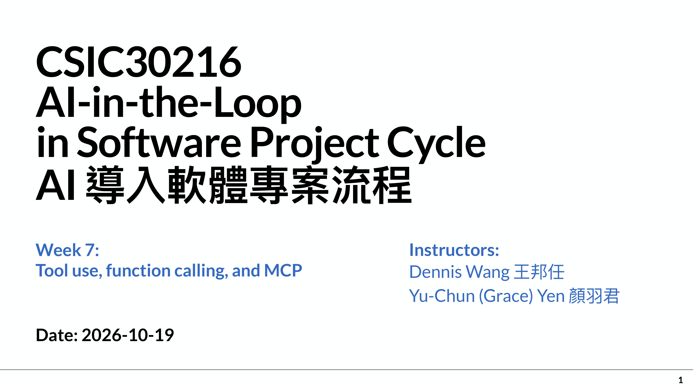
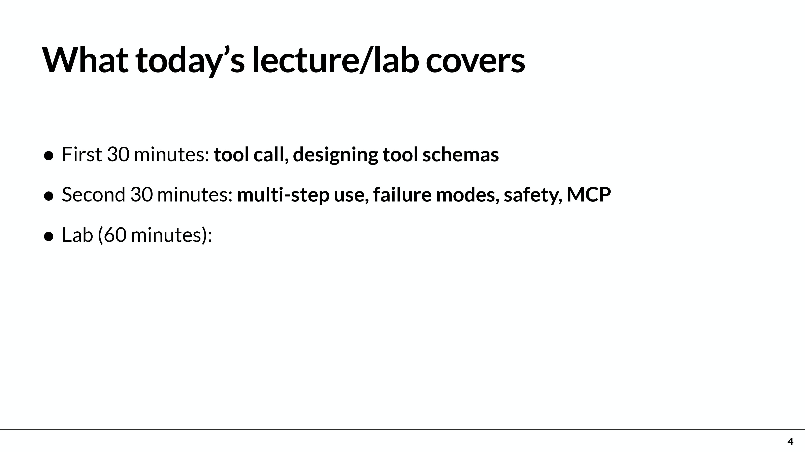
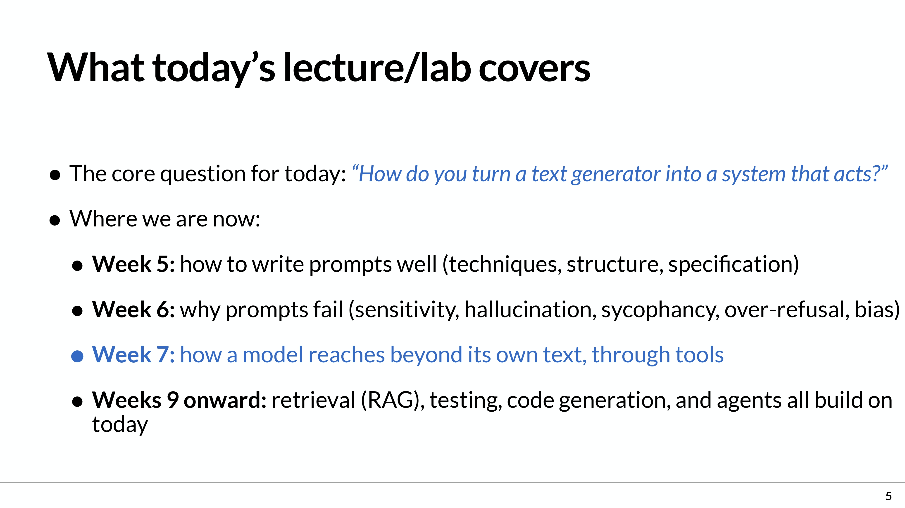

# Week 7 (2026-10-19)  Tool use, function calling, and MCP（工具使用、函式呼叫與 MCP）
## 教學資源：
- 講義[［week7-tool-function-use-mcp-261019.pdf］](https://github.com/414551016/AI-in-the-Loop-in-Software-Project-Cycle/blob/main/Lecture/week7-tool-function-use-mcp-261019.pdf)
- 教學影片：
  - 
- Prompt：教學說明
  - 請將本教學內容英/中翻譯對照 請說明本slide教學重點內容及你的看法，最後以250字內總結
- 作業[｛Week6_Lab｝](https://github.com/414551016/AI-in-the-Loop-in-Software-Project-Cycle/tree/main/Week6_Lab)

## 知識點：

# Week 7 (2026-10-19)課堂逐字稿
## slide：1 -2

  

- 教學內容英/中翻譯比對：
- 教學重點內容：
- 內容總結：

## slide：4 -6

  
  

