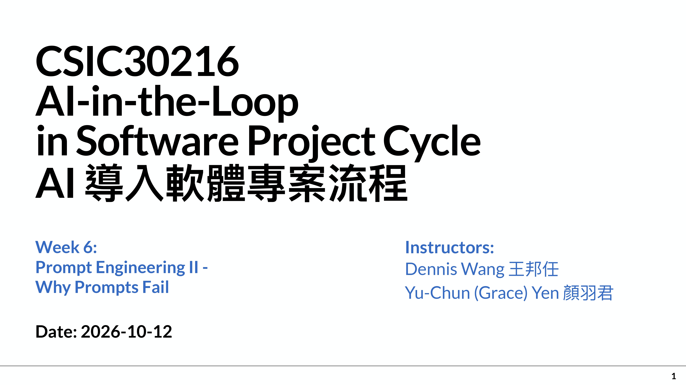

# Week 6 (2026-10-12) Prompt Engineering II — Why Prompts Fail（提示工程 II：提示為什麼會失敗）
## 教學資源：
- 講義[［week6-prompt-engineer-2-261012.pdf］](https://github.com/414551016/AI-in-the-Loop-in-Software-Project-Cycle/blob/main/Lecture/week6-prompt-engineer-2-261012.pdf)
- 教學影片：
  - [Prompt Engineering — Understanding Why Prompts Fail (Week 6) - Recorded Lecture - Part 1-1](https://e3p.nycu.edu.tw/mod/supervideo/view.php?id=244561)
  - [Prompt Engineering — Understanding Why Prompts Fail (Week 6) - Recorded Lecture - Part 1-2](https://e3p.nycu.edu.tw/mod/supervideo/view.php?id=244562)
  - [Prompt Engineering — Understanding Why Prompts Fail (Week 6) - Recorded Lecture - Part 2](https://e3p.nycu.edu.tw/mod/supervideo/view.php?id=244563)
- Prompt：教學說明
  - 請將本教學內容英/中翻譯比對 請說明本slide教學重點內容及你的看法，最後以250字內總結
- 作業[｛Week6_Lab｝](https://github.com/414551016/AI-in-the-Loop-in-Software-Project-Cycle/tree/main/Week6_Lab)

## 知識點：

# Week 6 (2026-10-12)課堂逐字稿
## slide：1 -2

  

- 教學內容英/中翻譯比對：
- 教學重點內容：
- 內容總結：

